<div align="center">

# SenseLab

**Real-time face and hand recognition that runs entirely in your browser.**
No server. No upload. No photos saved.

_Made by **Shevesh Pandey**_


[**Live demo**](#live-demo) · [Screenshots](#screenshots-and-demos) · [Gesture cheat sheet](#gesture-cheat-sheet) · [Architecture](#architecture-overview) · [Extend it](#extend-it-in-two-files) · [Run it](#quick-start)

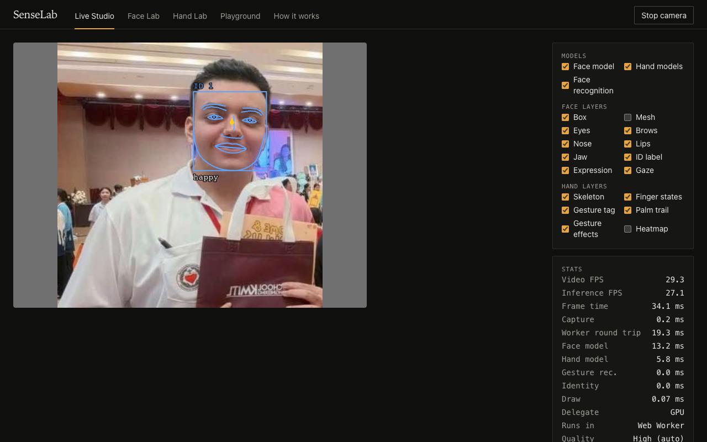

</div>

SenseLab points your webcam at a set of on-device models. It finds faces and hands, tracks them with stable IDs, reads
expressions, blinks, gaze and gestures, recognises people you register, and turns all of it into six small playable demos.
Everything runs in a Web Worker in your browser, and the page never uploads a frame.

## Live demo

> **Live site:** _add your Vercel URL here after `npx vercel --prod`_ (see [Deploy](#deploy)).
> No camera? Every demo also works with buttons and keyboard shortcuts, so you can try it all without one.

## Why it is interesting

|                             |                                                                                                                                                                                                                       |
| --------------------------- | --------------------------------------------------------------------------------------------------------------------------------------------------------------------------------------------------------------------- |
| **Private by construction** | A Content-Security-Policy with `connect-src 'self'` makes the browser itself refuse any request to another origin. Only names and numeric embeddings are stored, never photos or video. One click deletes everything. |
| **Fast on a laptop**        | 30 fps video loop, about 28 model results per second with face and hands on, measured on a Mac (numbers and caveats in [Performance](#performance-measured)). Inference never runs on the UI thread.                  |
| **Adapts to slow devices**  | An automatic quality mode steps work down when a frame overruns its deadline, then probes back up.                                                                                                                    |
| **Built to be extended**    | A new gesture is one file and one registry line. A new demo is one folder and one line. A test enforces that demos only use the event bus and the store.                                                              |
| **Tested end to end**       | 452 unit tests plus Playwright runs in real Chrome (and Playwright's WebKit) against a fake camera playing real photos and a recorded clip.                                                                           |

## What it does

- **Faces:** detection and 478 landmarks, stable IDs for up to 4 faces, five expressions, blinks and blinks per minute,
  gaze direction (with an optional 9-dot calibration), and recognition of people you register on the spot.
- **Hands:** 21 landmarks per hand, per-finger state, 13 static poses, swipes in four directions, wave, point with a
  direction, pinch and drag, circle, and two-hand zoom, rotate, clap, heart and frame.
- **Playground:** Air Draw, Slide Remote, 3D Object, Mirror Avatar, Blink Battle and Mood Meter, each also usable
  with a button or a key, no camera needed.
- **How it works page:** an architecture diagram and live per-stage timings from your own session.

## Screenshots and demos

|                                                                                                                           |                                                                                                    |
| ------------------------------------------------------------------------------------------------------------------------- | -------------------------------------------------------------------------------------------------- |
| 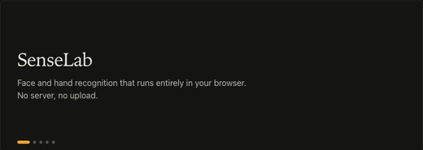                                                                    | 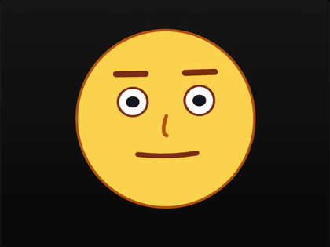                                       |
| **Slide Remote.** Next, previous and like, here driven with the keyboard. A swipe or thumbs up triggers the same actions. | **Mirror Avatar.** The cartoon copies smile, blinks, brows and head turn from the real face model. |
| 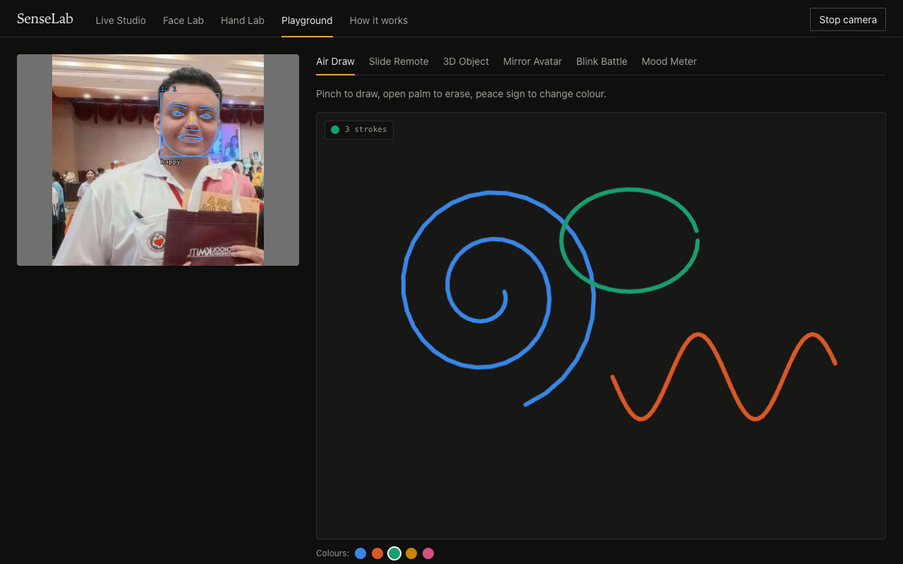                                                                     | 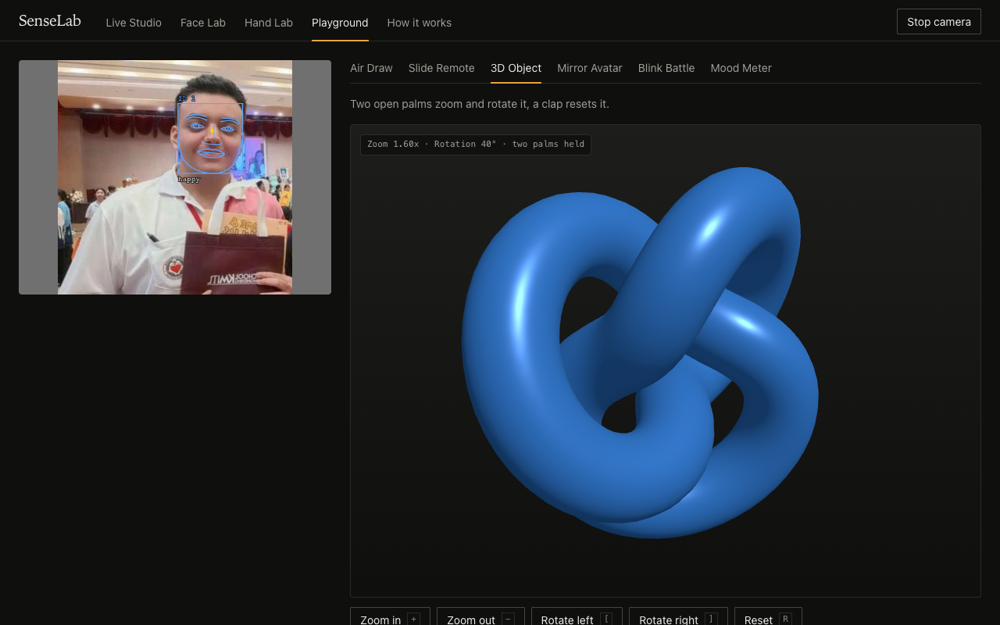                                                   |
| **Air Draw** (strokes made with simulated pinch input: there is no pinch photo to feed the camera).                       | **3D Object** at 1.6x and 40 degrees, from simulated two-hand input.                               |
| 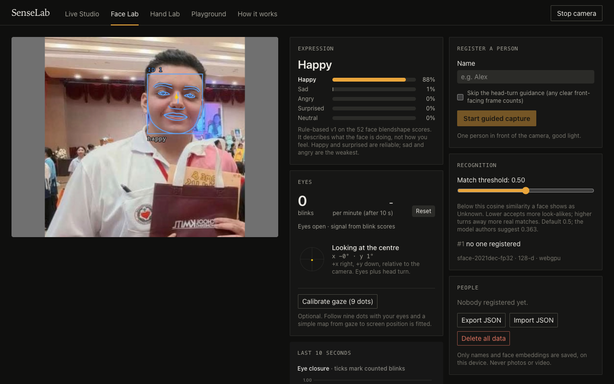                                                                                | 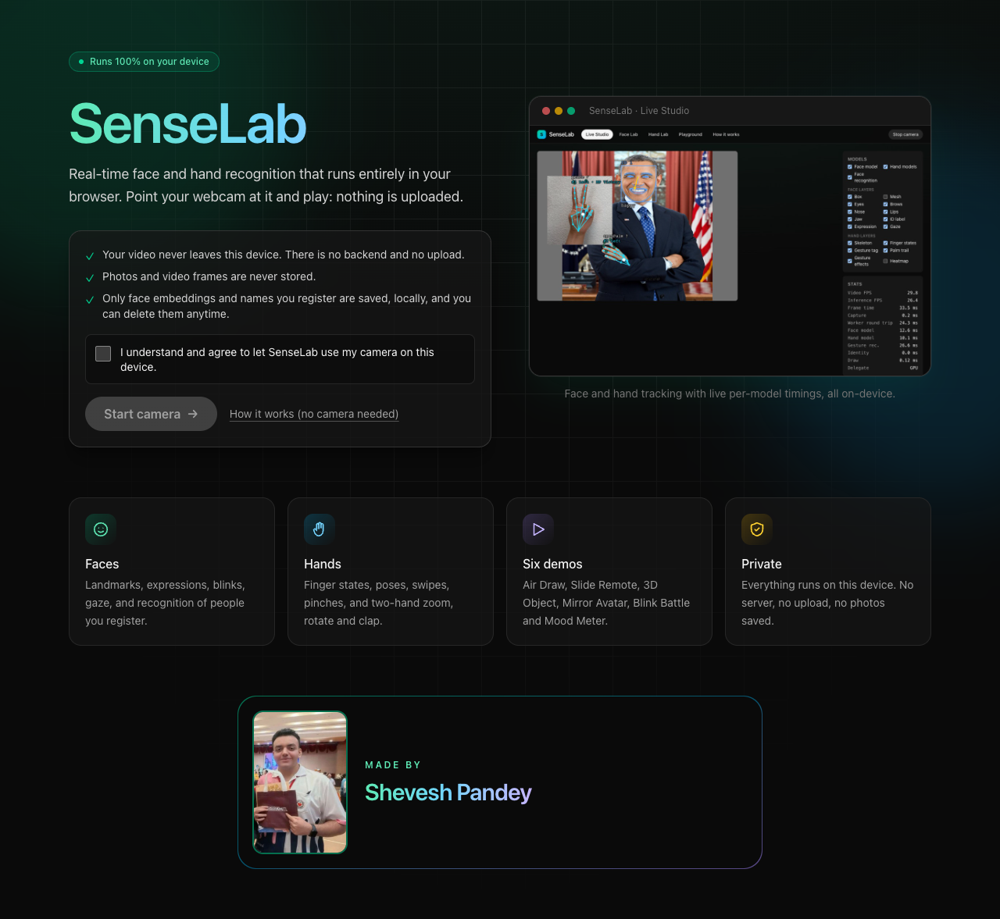                                                           |
| **Face Lab:** expression meter, blinks, gaze arrow, charts, registration.                                                 | **Welcome:** the consent page, before the camera starts.                                           |
| 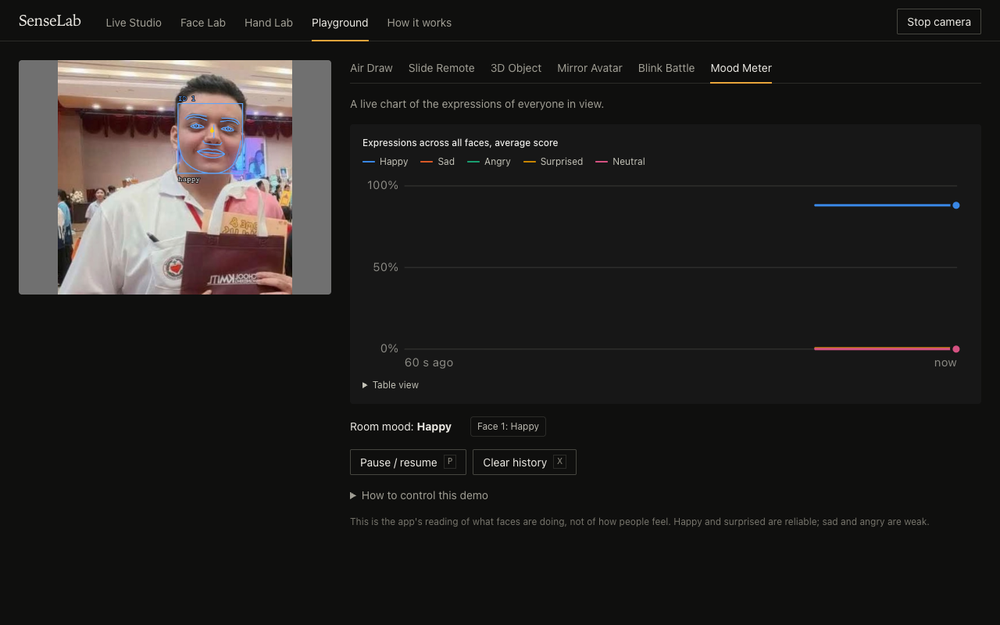                                                                       | 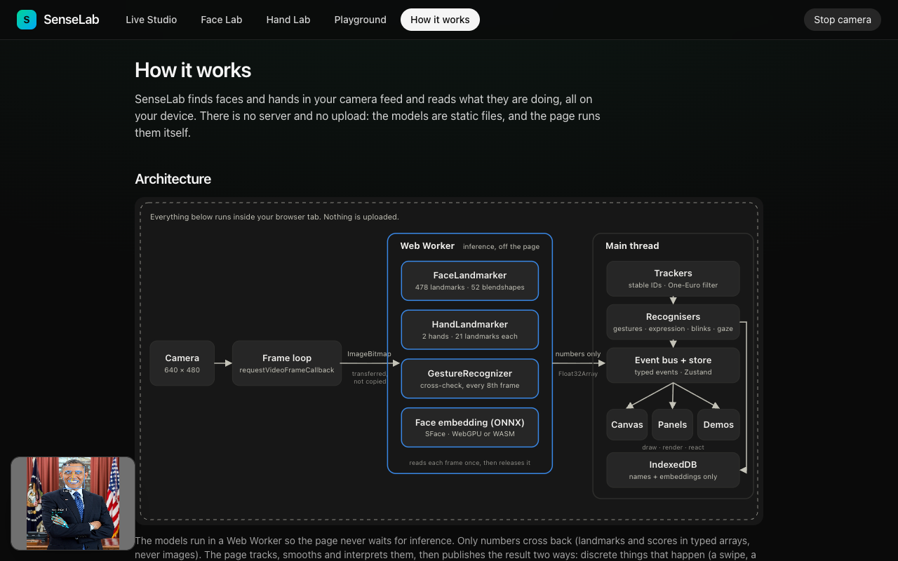                                                 |
| **Mood Meter:** a live chart of everyone's expressions.                                                                   | **How it works:** diagram and live timings.                                                        |

<details>
<summary><b>Try each demo (click to expand)</b></summary>

| Demo              | Do this                                                                                                               | No camera?                                                                                    |
| ----------------- | --------------------------------------------------------------------------------------------------------------------- | --------------------------------------------------------------------------------------------- |
| **Air Draw**      | Pinch thumb and index to draw, open your palm over the strokes to erase, show a peace sign to change colour.          | Draw with the mouse or touch; arrows and `Space` move a pen; `E` erase, `C` colour, `U` undo. |
| **Slide Remote**  | Swipe left for the next slide, right for the previous one, thumbs up to like.                                         | `←` `→` and `L`.                                                                              |
| **3D Object**     | Hold both open palms up and move them apart or together to zoom, turn the line between them to rotate, clap to reset. | `+` `-` zoom, `[` `]` rotate, `R` reset.                                                      |
| **Mirror Avatar** | Smile, blink, raise your brows, turn your head. The cartoon copies you.                                               | Sliders for each.                                                                             |
| **Blink Battle**  | Two people in frame. The first to blink loses.                                                                        | `Space` start, `1` / `2` mark a blink, `N` new round.                                         |
| **Mood Meter**    | Make an expression and watch the chart. Several faces are averaged.                                                   | `P` pause, `X` clear.                                                                         |

</details>

<details>
<summary><b>More: the Mirror Avatar page</b></summary>

The cartoon follows the face model's blendshapes and head pose; the camera is on the left.

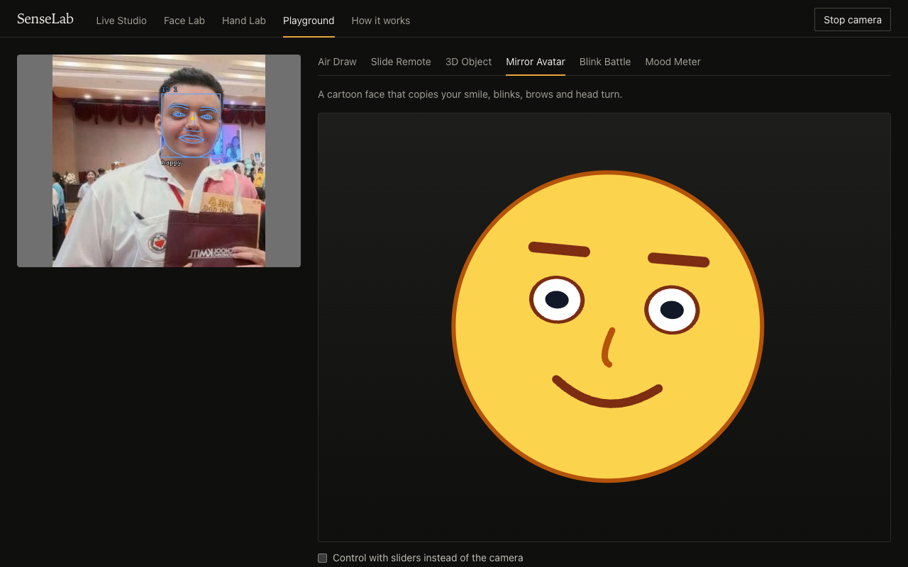

</details>

The Live Studio, Face Lab, Air Draw, 3D Object, Mood Meter and Avatar images are made by `tests/e2e/docsAuthor.spec.ts`
(`DOCS_DIR=docs FACE_FIXTURES=/folder npx playwright test docsAuthor`, where the folder holds a `portrait.jpg`): a fake camera
shows the author's own photo. Air Draw and 3D Object use simulated hand input, and the Slide Remote GIF is recorded with
keyboard input. There is no Hand Lab screenshot yet: it needs a photo of an open hand. The GIFs are cropped to the demo
panels. A screenshot is not a measurement: see "How accurate is it" below.

## Gesture cheat sheet

Every gesture is a typed event on the bus, for example `gesture:thumbsUp`. Poses and held gestures send `start` and `end`;
one-shots (swipes, wave, clap, circle) send `fire`.

| Group             | Gestures                                                                                                              | Event names                                                   |
| ----------------- | --------------------------------------------------------------------------------------------------------------------- | ------------------------------------------------------------- |
| **Poses** (13)    | 👍 thumbs up · 👎 thumbs down · ✌️ peace · 🖐 open palm · ✊ fist · ☝️ pointing up · 👌 OK · 🤘 rock · numbers 1 to 5 | `gesture:thumbsUp`, `gesture:peace`, `gesture:fist`, ...      |
| **Motion** (9)    | ⬅️➡️⬆️⬇️ swipes · 👋 wave · 👉 point (with direction) · 🤏 pinch and pinch-drag · ⭕ circle                           | `gesture:swipeLeft`, `gesture:wave`, `gesture:pinchDrag`, ... |
| **Two hands** (5) | 🔍 zoom · 🔄 rotate · 👏 clap · 🫶 heart · 🖼 frame                                                                    | `gesture:zoom`, `gesture:clap`, `gesture:heart`, ...          |

Face events: `face:blink` (with duration and running count) and `face:expression` (from, to).

## Extend it in two files

**Listen to events** from anywhere in the UI (the typed bus rejects event names that do not exist):

```ts
import { bus } from './events/bus';

const off = bus.on('gesture:swipeLeft', (e) => {
  console.log(`swipe left, confidence ${e.confidence.toFixed(2)}`);
});
// off() unsubscribes
```

**Add a gesture** with one file and one registry line. This is the real thumbs-up detector
(`src/features/hand/static/thumbsUp.ts`): a confidence from finger curl and thumb direction. The engine adds the hold-frames
requirement, the threshold and the cooldown.

```ts
export const thumbsUp = () =>
  createStaticGesture({
    id: 'thumbsUp',
    confidence: (f) =>
      Math.min(
        clamp01((0.7 - f.curl[THUMB]!) / 0.4), // thumb extended
        clamp01((f.metrics.thumbUp - 0.4) / 0.4), // thumb pointing up
        // the other four fingers curled
        closed(f, INDEX),
        closed(f, MIDDLE),
        closed(f, RING),
        closed(f, PINKY),
      ),
  });
```

then register it in `src/features/hand/static/index.ts` (order is priority when several poses match).

**Make a demo accessible** by declaring its actions once. The same declaration draws the buttons and registers the keys, so
nothing can be done only with a gesture (`src/demos/slides/actions.ts`):

```ts
export const SLIDE_ACTIONS: readonly ActionSpec<SlideAction>[] = [
  { id: 'prev', label: 'Previous slide', gesture: 'Swipe right', key: 'ArrowLeft', keyLabel: '←' },
  { id: 'next', label: 'Next slide', gesture: 'Swipe left', key: 'ArrowRight', keyLabel: '→' },
  { id: 'like', label: 'Like', gesture: 'Thumbs up', key: 'l', keyLabel: 'L' },
];
```

## Quick start

```
npm install
./scripts/fetch-models.sh     # downloads the models and copies the runtimes into public/models (about 150 MB)
npm run dev                   # open the printed URL, tick the consent box, press Start camera
```

The camera needs `localhost` or HTTPS. To try it on a phone, run an HTTPS tunnel such as ngrok against the dev server
(ngrok hosts are already allowed in `vite.config.ts`). Other scripts: `npm run typecheck | lint | test | build | preview`.

## The playground

Every gesture action is declared once (`src/demos/*/actions.ts`) with its gesture, its button and its key, and the same
declaration draws the buttons and registers the shortcuts, so nothing can be done only with a gesture.

| Demo              | By gesture                                                                              | By button / key                                                                                         |
| ----------------- | --------------------------------------------------------------------------------------- | ------------------------------------------------------------------------------------------------------- |
| **Air Draw**      | pinch to draw; open palm erases what it touches; peace sign changes colour              | mouse or touch to draw; arrows move a pen and `Space` puts it down; `E` erase all, `C` colour, `U` undo |
| **Slide Remote**  | swipe left: next slide; swipe right: previous; thumbs up: like                          | `Right` / `Left` / `L`                                                                                  |
| **3D Object**     | two open palms apart or together: zoom; turn the line between them: rotate; clap: reset | `+` `-` zoom, `[` `]` rotate, `R` reset                                                                 |
| **Mirror Avatar** | copies your smile, blinks, brows, jaw and head turn                                     | sliders for each, no camera needed                                                                      |
| **Blink Battle**  | two faces: the first to blink loses (player 1 is on the left of the screen)             | `Space` start, `1` / `2` for a player blinking, `N` new round                                           |
| **Mood Meter**    | live chart of everyone's expressions over the last minute                               | `P` pause, `X` clear                                                                                    |

**Demos only use the event bus and the store.** They read live data from `core/frameStore` and listen to typed events on
`events/bus`, and never import a model, the worker or the pipeline. `tests/demoRules.test.ts` scans every import in
`src/demos` and fails if that changes. Adding a demo is a folder under `src/demos` plus one line in `registry.ts`.

## Architecture overview

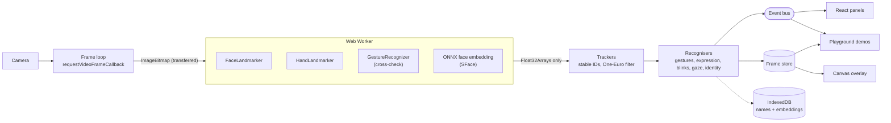

- **The page never runs inference.** Models run in a module Web Worker. Frames go in as `ImageBitmap`s (one in flight at a
  time: if the worker is busy the next frame is dropped), and only flat typed arrays come back.
- **Each model has its own schedule.** Face and hands every frame, the gesture recogniser every 8th frame and only with a
  hand in view, face recognition for new faces and about every 500 ms per face.
- **Models load when first needed, one at a time:** face tracking first, then hands, the gesture cross-check when a hand
  first appears, face recognition when a face first appears. A failed load shows a message with a Retry button and the
  other models keep working.
- **Automatic quality.** If a processed frame costs more than its deadline (33 ms at full rate) for a moment, the app
  steps down a level (drop the gesture cross-check and the heaviest overlays, then every other frame and no recognition
  for new faces) and tries a level up again after a calm stretch, backing off if that fails. Level and an override
  are in the Stats panel.
- **A service worker** caches the app and the models, so later visits start without downloading anything and work offline.
- **No React re-render per frame.** Live data lives in module-level trackers and the frame store; the canvas is drawn
  straight from them; panels poll a few times a second.
- **Everything smoothed with a One-Euro filter,** not a moving average.
- **Typed event bus** for everything the UI reacts to (`gesture:swipeLeft`, `face:blink`, ...).

### One frame, end to end

```mermaid
sequenceDiagram
  participant V as Video frame
  participant L as Frame loop (page)
  participant W as Worker (models)
  participant T as Trackers + recognisers
  participant U as Canvas, panels, demos
  V->>L: new camera frame
  L->>L: scheduler picks the models for this frame
  L->>W: ImageBitmap (transferred, not copied)
  W->>W: face, hands, gesture, identity (as scheduled)
  W-->>L: Float32Arrays and small results only
  L->>T: smooth (One-Euro), match IDs, read gestures and expressions
  T->>U: events on the bus, live state in the store
  Note over L,W: one frame in flight; if the worker is busy the next frame is dropped
```

### Automatic quality

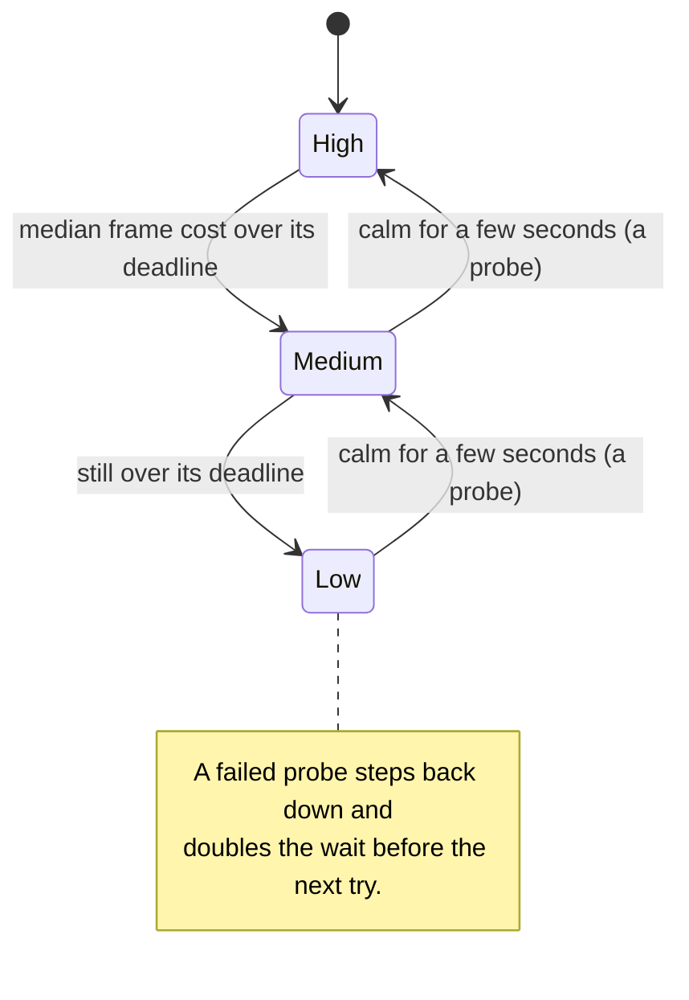

```
src/
  core/        camera, worker (protocol, client, inference worker), scheduler, tracking, stats, pipeline, frame store
  features/    face/ (detect, landmarks, identity, expression, eyes)  hand/ (fingers, static/, dynamic/, twoHand/)
  events/      the typed event bus
  render/      canvas overlays and the heatmap
  storage/     IndexedDB people store, export / import
  demos/       the six playground demos
  ui/          pages, panels, components
tests/         unit tests, e2e/ (Playwright), fixtures/ (real and synthetic recordings, see its README)
scripts/       fetch-models.sh, eval-identity.mjs, eval-expressions.mjs
docs/          screenshots and GIFs for this README
```

The in-app **How it works** page shows the same diagram as an SVG, with live per-stage timings from your session.

## Privacy

- The camera starts only after you tick the consent box. Stopping releases it.
- There is no backend. After the models load, the page requests only its own static files (checked by an automated test).
- Only a name and a short list of numbers (an embedding) per registered person are saved, in your browser's IndexedDB.
  Never photos or video frames. One click deletes one person or everything; people can be exported and imported as JSON.
- Fonts are the system fonts: no web-font request.
- The deployed site sends a Content-Security-Policy with `connect-src 'self'`, so the browser itself refuses any request to
  another origin (see "Deploy"). Once you tick the consent box the page starts downloading the face model and runtime from
  its own origin so Start is quicker; no camera is touched by that.

## Status against the original brief

**Done and tested:** everything on the feature list, the event bus, the worker pipeline with per-model scheduling,
automatic quality mode, lazy model loading, the service worker, One-Euro smoothing, the gesture interface, consent /
delete / export / import, no network after load, all pages, the six demos, error handling for every camera and model
failure, unit tests and Playwright end-to-end tests.

**Worker or main thread:** models run in a **module Web Worker**. MediaPipe's classic loader needs `importScripts()`, which
module workers lack, so the worker uses MediaPipe's ES-module loader (`useModule`); that also means no `eval` and a strict
Content-Security-Policy. A browser without module workers (Safari before 15) falls back to running the models on the page,
which costs smoothness; `?thread=main` forces it for testing.

**Not measured:** the speed targets on a mid-range laptop and on a phone (see "Performance" for what was measured, on one
Mac), and anything on a real iPhone.

**Tested on photos, clips and a fake camera, not on a live person:** recognition of you and a friend, blink counting, the
two-hand heart and frame gestures, pinch drawing and two-hand zoom (those use simulated input). The real model paths that
are checked end to end: swipes, thumbs up, expressions, the avatar, blinks, two-face Blink Battle and the mood chart.

**Known limits:** see "Known limitations" on the How it works page: lighting, no liveness check (a photo of a registered
person is recognised as them), uneven accuracy across people, expressions are not emotions, gaze is rough.

## Performance (measured)

All numbers below are from this development Mac, Chrome with a real GPU, face and hands on, fed by a fake camera playing
`tests/fixtures/clip-face.mjpeg` (a still portrait with slow motion, so there is always a face and no hand). They were not
measured with a live webcam, and not on a phone or a mid-range laptop. Run `CHROME=1 npx playwright test clip` to get yours.

| What                                    | Measured                                                                  |
| --------------------------------------- | ------------------------------------------------------------------------- |
| Video loop                              | 30 fps                                                                    |
| Model results per second                | 21.9 to 30.0 across several 8 s runs, every sample above the 15 fps floor |
| Worker round trip per frame             | 23.3 ms                                                                   |
| Face model / hand model                 | 12.0 ms / 10.0 ms (gesture cross-check 13.9 ms, one frame in 8)           |
| Capture / overlay draw                  | 0.1 ms / 0.09 ms                                                          |
| Same app in Playwright's WebKit (macOS) | 26.0 results/s; face 12.8 ms, hand 10.2 ms, GPU delegate                  |

**Time from pressing Start to the first face box** (production build, `tests/e2e/launch.spec.ts`):

| Situation                                                                | First visit | Later visit |
| ------------------------------------------------------------------------ | ----------- | ----------- |
| Local server, no limit                                                   | 1.1 s       | 0.56 s      |
| 20 Mbit/s + 30 ms, pressing Start right after ticking the box            | 6.4 s       | 0.58 s      |
| 20 Mbit/s + 30 ms, after 5 s of reading the page (face stack prefetched) | 1.4 s       | 0.63 s      |

The 3 s first-visit target is **not met on a 20 Mbit/s link unless the person spends a few seconds on the welcome page**.
What has to arrive first is the face model (3.7 MB) and MediaPipe's WASM (14.6 MB raw, 4.1 MB gzip, 3.3 MB brotli). The test
server sends files uncompressed; whether your host compresses `.wasm` decides how much better a real deployment does, and
that has not been checked on Vercel. The throttle is a local proxy giving each connection the full speed, so it is optimistic
when files download in parallel. The later-visit target (under 1 s) is met: those loads come from the service worker's cache.

**Quality levels** (`tests/e2e/quality.spec.ts`, level pinned, same machine): High 23.3 ms per frame and 26.7 results/s;
Medium 31.0 ms and 24.2/s; Low 33.2 ms and 14.9/s. A lower level does **not** make one frame cheaper here (the models even
report slower times, probably because the GPU clocks down under lighter load; not confirmed): Low only halves the rate.
The mode's logic is checked by unit tests and, in the browser, by throttling the CPU 12x: it steps down from High, and
returns to High after the load is removed. On a machine that really cannot keep up, expect it to settle on the first level
whose deadline it meets and probe upward now and then. Shrinking the frame sent to the worker was tried and removed: it made
the models slower (the resized bitmap is no longer a GPU texture).

## Bundle sizes

`ANALYZE=1 npm run build && node scripts/bundle-report.mjs` prints this for the current build.

| Part                                          | Raw          | Gzip        | When it loads                           |
| --------------------------------------------- | ------------ | ----------- | --------------------------------------- |
| **First load** (page, React, welcome, styles) | 262.6 kB     | 80.0 kB     | immediately                             |
| Studio page and panels                        | 106.8 kB     | 35.2 kB     | when you tick the consent box           |
| Worker (MediaPipe glue, ONNX runtime loader)  | 161.2 kB     | 48.1 kB     | when the camera starts                  |
| 3D Object demo (Three.js)                     | 521.9 kB     | 128.2 kB    | when that demo is opened                |
| Other demos, How it works                     | about 190 kB | about 65 kB | on demand                               |
| Main-thread fallback engine                   | 159.9 kB     | 47.5 kB     | only in browsers without module workers |

Models and runtimes are not part of the JS: face landmarks 3.7 MB, hand landmarks 7.6 MB, gesture recognizer 8.2 MB, face
recognition 37.8 MB, MediaPipe WASM 14.6 MB, ONNX runtime WASM 28.1 MB (WebGPU build) or 14.5 MB (CPU build). Vite used to emit
unused copies of the ONNX WASM into the build (42 MB, which the service worker would have precached); a build plugin now drops them.

## Browsers, Safari and iOS

The app probes the browser (`src/core/capabilities.ts`) and takes the simplest path that works. The welcome page lists what
this browser lacks, and the Stats panel shows "Runs in".

| Missing                                 | What happens                                                           |
| --------------------------------------- | ---------------------------------------------------------------------- |
| Module workers (Safari before 15)       | models run on the page, slower and less smooth                         |
| `createImageBitmap(video)`              | frames are copied through a canvas first (`?capture=canvas` forces it) |
| `requestVideoFrameCallback`             | frame loop uses `requestAnimationFrame`                                |
| WebGL 2 / GPU delegate                  | MediaPipe uses its CPU path                                            |
| WebGPU                                  | face recognition uses the WASM build (Safari today)                    |
| Secure context, camera API, WebAssembly | a plain message on the welcome page, Start is disabled                 |

**What was tested:** Chrome (all end-to-end specs), the main-thread path and the canvas capture path forced in Chrome, and
Playwright's WebKit build on macOS (`WEBKIT=1 FACE_FIXTURES=... npx playwright test webkit`): it takes the worker path, gets the
GPU delegate, tracks a face and a hand, and ran at 26 results/s. That is WebKit, not Safari: it says nothing about iOS memory
limits (the face-recognition model is 37.8 MB), background-tab rules or the real camera pipeline. **Nothing was run on a real
iPhone or in Safari.** Please try it there and report what you see.

**Found on an iPad:** with Chrome on iPadOS (which is WebKit underneath) both models failed with "Can't find variable:
document". MediaPipe's loader tells a worker from a page by `typeof importScripts === 'function'`; WebKit leaves
`importScripts` undefined in module workers, so the loader reached for `document`. The worker now defines an `importScripts`
that throws the same `TypeError` Chrome's does (`src/core/worker/importScriptsShim.ts`), which sends the loader to `import()`.
A second cause sat behind it: MediaPipe only uses an `OffscreenCanvas` if the user-agent has a `Version/17` Safari token,
and Chrome and Firefox on iPhone and iPad have none, so it called `document.createElement("canvas")` inside the worker. The
models are now given their own `OffscreenCanvas` (`taskCanvas()` in `src/features/mediapipeFileset.ts`); a browser with no
WebGL 2 `OffscreenCanvas` starts on the main thread; and if the worker still fails for a browser reason, the pipeline switches
to the main thread once, automatically. Both failures were reproduced in Chrome (hiding `importScripts`, and an iPad-Chrome
user-agent in `tests/e2e/ios.spec.ts`) and fixed there. **Neither has been re-checked on a real iPad or iPhone.**

**Test notes for Safari / iOS:** use HTTPS (an ngrok tunnel works), tick the consent box, and watch the Stats panel: "Runs in",
"Delegate" and "Quality" tell you which path you got. Check that the camera starts after the permission prompt, that a face box
appears, that hands work, and that locking the phone and returning does not leave stale tracks. `?thread=main` and
`?capture=canvas` on the URL force the fallbacks. The Content-Security-Policy uses `wasm-unsafe-eval`, which Safari supports
from version 16; older versions would block WebAssembly on a deployment that sends it.

## Deploy

`vercel.json` is ready for **Vercel** (`npx vercel --prod`, HTTPS is automatic and the camera needs it). The build command runs
`scripts/fetch-models.sh` first, so the models are downloaded from their hosts at build time (about 100 MB); nothing external
is fetched at run time. **Not deployed or tested on Vercel from here.** Cloudflare Pages was not chosen: it limits files to
25 MiB, and the face-recognition model (37.8 MB) and the ONNX WebGPU WASM (28.1 MB) are larger.

Headers (the same ones `npm run preview` sends, so the end-to-end tests run under them):

- `Content-Security-Policy`: everything from `'self'`; scripts `'self'` plus `'wasm-unsafe-eval'` (WASM only; no `eval`, no
  `blob:`); `connect-src 'self'`, which makes the browser enforce the "no third-party requests" rule; `object-src 'none'`,
  `frame-ancestors 'none'`. Inline styles are allowed because Framer Motion sets them.
- `X-Content-Type-Options`, `Referrer-Policy: no-referrer`, `Strict-Transport-Security`, and a `Permissions-Policy` that allows
  only the camera, for this origin.
- Long cache lifetimes for the hashed `assets/` files, a day for `models/`, and `no-cache` for `sw.js`.

**COOP / COEP are not set.** They are needed only for threaded WASM (`SharedArrayBuffer`). The ONNX runtime is configured for one
thread and MediaPipe's WASM is single-threaded, so nothing needs cross-origin isolation, and setting them would only add
risk. Nothing breaks without them; I did not try the app with them on.

## Face recognition: the model, where it goes, and the licenses

MediaPipe can find and track faces but cannot tell people apart, so identity uses a separate face-embedding
model run with onnxruntime-web inside the worker.

**The model:** SFace from the OpenCV Zoo, a MobileFaceNet trained with the SFace loss. 112x112 aligned input,
128-number embedding, 99.4% on the standard LFW benchmark according to its authors.

|               |                                                                                                                                                                                     |
| ------------- | ----------------------------------------------------------------------------------------------------------------------------------------------------------------------------------- |
| File          | `face_recognition_sface_2021dec.onnx` (38.7 MB, fp32)                                                                                                                               |
| Put it in     | `public/models/face_recognition_sface_2021dec.onnx`                                                                                                                                 |
| Download      | https://huggingface.co/opencv/face_recognition_sface/resolve/main/face_recognition_sface_2021dec.onnx                                                                               |
| Easiest       | `./scripts/fetch-models.sh` does this for you and also saves the license as `public/models/LICENSE-sface.txt`                                                                       |
| Optional int8 | `face_recognition_sface_2021dec_int8.onnx` (9.9 MB), `WITH_INT8=1 ./scripts/fetch-models.sh`, then set `ACTIVE_IDENTITY_MODEL = SFACE_INT8` in `src/features/face/identityModel.ts` |

If the file is missing, faces and hands still work and Face Lab tells you to run the script.

**fp32 rather than int8.** I measured both on 224 photos (see "How accurate is it" below). Accuracy is the same, but in
onnxruntime-web the int8 file is several times slower, because the quantised graph is dequantised on the CPU:

| Model / backend | Time per face (incl. face detection, still image) | Same-person scores (lowest) | Different-person scores (highest) |
| --------------- | ------------------------------------------------- | --------------------------- | --------------------------------- |
| fp32, WebGPU    | 22 ms                                             | 0.605                       | 0.441                             |
| fp32, WASM      | 42 ms                                             | 0.605                       | 0.441                             |
| int8, WASM      | 100 ms                                            | 0.590                       | 0.421                             |
| int8, WebGPU    | 135 ms                                            | 0.590                       | 0.421                             |

The app uses WebGPU when the browser has it and falls back to WASM otherwise. int8 is 4x smaller to download, which
may matter more than speed on a slow connection.

### Licenses (read before using this commercially)

- **SFace (the model used here)** is under the **Apache 2.0** license (the whole OpenCV Zoo directory it comes from). The
  model's README does not say which dataset it was trained on, so if you plan commercial use, check the terms of that
  training data yourself; Apache 2.0 covers the files, not the data behind them.
- **Many other pretrained face models are for non-commercial or research use only.** In particular the InsightFace
  pretrained models (`buffalo_*`, `w600k_mbf`, `glint360k` ...) are research / non-commercial, and many ArcFace,
  MobileFaceNet and FaceNet checkpoints on GitHub and Hugging Face were trained on datasets (MS-Celeb-1M and similar) that
  carry research-only terms or were withdrawn. Do not swap one in without reading its license.
- **MediaPipe models and tasks-vision** are Apache 2.0. **onnxruntime-web** is MIT.
- **LFW**, the public photo set used for the accuracy test below, is a research dataset. Its photos are **not** in this
  repository, and the small fixture `tests/fixtures/identity_embeddings.json` contains only numbers derived from them.
- A face embedding is biometric data in many jurisdictions. That is why the app asks for consent, stores only names and
  embeddings (never photos or video), and offers one-click delete plus export / import.

### Using a different model

Embeddings from different models cannot be compared. Add a spec to `src/features/face/identityModel.ts` (file name, input
size, `mean` / `scale` normalisation, embedding length), point `ACTIVE_IDENTITY_MODEL` at it and put the file in
`public/models/`. People registered with another model stay in storage (Face Lab marks them "other model") but are not matched.

## How face recognition works

1. MediaPipe FaceLandmarker (in the worker) gives 478 landmarks per face; the tracker keeps a stable ID per face.
2. For a new face, and then about every 500 ms per face (never every frame, at most 2 faces per frame), the main thread asks
   the worker to embed it. The worker aligns the face from 5 points (iris centres, nose tip, mouth corners) to 112x112, runs
   the model and returns an L2-normalised embedding.
3. The embedding is compared by cosine similarity with every registered person's mean embedding. The best match counts as that
   person if it reaches the threshold, otherwise the face is "Unknown".
4. Each tracked face keeps its last 5 results and shows the majority vote, so the label does not flicker. The threshold is applied
   when the vote is read, so moving the slider re-judges immediately.
5. Blurry or dark crops (Laplacian variance, brightness) do not vote.

Registration (Face Lab): front, left, right, up, down, 2 good frames each (10 in total). Frames are skipped, with a hint, when
too dark, too bright, too blurry, not exactly one face, or the head is not in the requested pose. The head-pose check uses
the nose position relative to the eyes and mouth, not matrix angles; its direction convention is reasoned, not verified
against a real turning head, so there is a "Skip the head-turn guidance" option and a "Skip this pose" button.

## How accurate is it

`scripts/eval-identity.mjs` takes a folder with one sub-folder of images per person and prints false-reject and false-accept rates
at several thresholds, using the app's real pipeline in a headless browser and the same "person = mean of their embeddings"
matching (leave-one-out):

```
node scripts/eval-identity.mjs faces/ --enroll 5 --thresholds 0.30:0.65:0.05
```

Result on 224 LFW photos, 14 people with 16 photos each, each person's reference built from 5 other photos, SFace fp32
(224 same-person and 2,912 different-person comparisons):

| threshold | false reject | false accept |
| --------- | ------------ | ------------ |
| 0.30      | 0.00%        | 2.88%        |
| 0.35      | 0.00%        | 1.13%        |
| 0.40      | 0.00%        | 0.14%        |
| 0.45      | 0.00%        | 0.00%        |
| 0.50      | 0.00%        | 0.00%        |
| 0.55      | 0.00%        | 0.00%        |
| 0.60      | 0.00%        | 0.00%        |
| 0.65      | 1.79%        | 0.00%        |

Same-person scores ranged from 0.605 up (median 0.82); different-person scores topped out at 0.441 (99th percentile 0.353).
**The default threshold is 0.50**, the middle of the zero-error range 0.45-0.60. The model's authors suggest 0.363.

**Read these numbers with care.** They come from news photos of public figures, 14 people, the same photo source for
reference and test, and every person had at least 16 photos. A webcam in your room, a friend who looks like you, different light
on a different day or a person wearing glasses will be harder. The threshold slider exists for that; tune it on your own
camera. What these numbers do not cover: nobody has yet registered themselves live with this app and been recognised through
a real webcam, and nothing here tests identical twins or close relatives.

## Expressions and eyes (Face Lab)

Everything below runs on the main thread from the 52 blendshape scores, the smoothed landmarks and the head pose that
the worker already returns. It costs under 4 microseconds per frame for four faces.

**Expressions** (the UI says "expressions", not "emotions": it reads what the face is doing, not how someone feels).
`src/features/face/expression/` has a rule-based v1 classifier behind a small interface
(`classify(blendshapes, out) -> label`), so a trained model can replace it without touching anything else. Each of
happy / sad / angry / surprised gets an evidence score from the few blendshapes that define it (a smile suppresses the
others, raised brows suppress anger); "neutral" is a real competing score that wins when nothing reaches the evidence
bar. Scores are averaged over 5 frames and the label only changes after a different one has led for 4 frames in a row
and by a margin, so one odd frame never flips it.

**Blinks.** `eyeBlinkLeft/Right` with hysteresis: the eyes count as closed at 0.55 and open again at 0.30. The signal is
`min(left, right)`, so a wink is not a blink; a closure under 30 ms (noise) or over 800 ms (eyes held shut) is not
counted. Blinks per minute is shown after 10 s of data. If a face has no blendshape scores for half a second, the
landmark eye-aspect-ratio takes over (it correlates -0.84 with the blink scores on real photos).

**Gaze.** Iris centre relative to the eye corners (measured along the corner line and in eye widths, so head roll and
distance do not matter), plus the head's yaw and pitch, giving a direction relative to the camera in approximate
degrees (+x right, +y down, as the user sees the mirrored view). Left / right / up / down / centre with hysteresis.
Optional: a 9-dot calibration fits a linear map from gaze to screen position and reports its error on dots left out of
the fit.

### How well does it work (measured)

Expressions, from `scripts/eval-expressions.mjs`. The rules were designed from blendshape distributions and tuned
with a small parameter search on a **tuning split only**; these numbers are on photos the tuning never saw. Two public
sets were used, and neither is in this repository (only numbers derived from them):

| Held-out set                                                                  | Photos | Result                            |
| ----------------------------------------------------------------------------- | ------ | --------------------------------- |
| In-the-wild photos (AffectNet-style, 5 expressions)                           | 495    | **51.9%** correct (chance is 20%) |
| Posed expressions (CK+, 4 expressions, different people from the tuning ones) | 315    | **88.9%** correct                 |

| Expression | in the wild: recall | posed: recall |
| ---------- | ------------------- | ------------- |
| happy      | 88%                 | 100%          |
| surprised  | 49%                 | 97%           |
| angry      | 44%                 | 75%           |
| sad        | 36%                 | 59%           |
| neutral    | 42%                 | (not in CK+)  |

For reference, a logistic regression trained on all 51 blendshapes reaches about 57% on the in-the-wild photos in
cross-validation, so about 52% is near what blendshape-based methods get on labels this noisy (they are annotators'
opinions of ordinary photos). Happy and surprised are reliable; sad and angry are weak and overlap with neutral; the
model's `mouthFrown`, `cheekSquint` and `noseSneer` scores are almost always zero, so no rule uses them. Posed
expressions, like the ones you make on purpose, are much easier than the ordinary photos.

Eyes, checked against real photos:

- Landmark eye-aspect-ratio vs the blink scores: correlation **-0.84** (about 0.03 when closed, 0.30 open).
- Iris-based sideways gaze vs MediaPipe's own eye-look scores: **+0.79**; vertical **+0.58** (weaker: the eyelids
  limit how far the iris visibly moves up and down, so up/down gaze is the least reliable part).
- Directions were confirmed by looking at the extreme photos: faces turned toward the image's left have positive yaw,
  chin-down faces have positive pitch, eyes looking toward the image's left read as +x. The matrix yaw from the
  transformation matrix has the opposite sign (correlation -0.96 with the mesh geometry), which the code corrects.
  This also settles the head-pose direction question left open in the face-registration guidance.
- The head-pose correction itself is physics (gaze = eye direction + head direction), not a fit: in these photos people
  tend to look where their head points, so the correction cannot be validated statistically.

**Not measured:** blink counting has only been tested on synthetic blink traces (with realistic timing and noise) and
on a fake camera that swaps an open-eye and a closed-eye photo; it has not been checked against a person blinking.
Gaze accuracy in degrees has no ground truth here, only direction. The calibration is tested on synthetic data, and its
end-to-end run only on a still face (where it correctly reports that the gaze never changed).

Re-run the expression numbers on your own photos:
`node scripts/eval-expressions.mjs photos/` with one sub-folder per expression (`happy`, `sad`, `angry`, `surprised`,
`neutral`).

### Data used for this phase

Real photos were used only on this machine for measurement and are not stored in the repository:
a public re-upload of AffectNet (a research dataset, non-commercial terms) and CK+ (the Hugging Face copy used is marked
CC0; the original dataset has its own usage conditions). The committed fixtures
(`tests/fixtures/expression_blendshapes.json`, `eyes_real_photos.json`) contain only numbers (blendshape scores,
a few landmark coordinates, head-pose angles), never images. If you plan commercial use, check those datasets' terms.

## Tests

- `npm test`: unit tests (452, in `tests/`). Fixtures are described in `tests/fixtures/README.md`.
- Playwright end-to-end tests in `tests/e2e/` run Chrome against a fake camera. Several need photos or videos you supply
  and skip themselves without them:

| Set this                                                              | For                                                                                                                                                                                |
| --------------------------------------------------------------------- | ---------------------------------------------------------------------------------------------------------------------------------------------------------------------------------- |
| nothing                                                               | `errors` (camera denied / missing / lost, model failure, hidden tab), `clip` (face box + FPS floor from `tests/fixtures/clip-face.mjpeg`)                                          |
| `FACE_FIXTURES=/path` (a folder of named photos)                      | `faceLab`, `playground`, `quality`, `fallback`, `docs`: `happy surprised angry sad neutral open closed gazeScreenLeft gazeScreenRight gazeCentre victory thumb_up portrait` (.jpg) |
| `LFW_DIR=/path` (one folder per person)                               | `identity`, `identityPerf`                                                                                                                                                         |
| `FAKE_VIDEO=/path/file.y4m`                                           | `studio`, `hands`, `swipe`, `triggers`                                                                                                                                             |
| `PORT=4173` (after `npm run build && npm run preview -- --port 4173`) | `prod`, `pwa` (service worker + offline), `launch` (time to first face box; `THROTTLE_MBPS=20`, `DWELL_MS=5000`, `TIMELINE=1`), and `clip` against the production build            |
| `WEBKIT=1` + `FACE_FIXTURES`                                          | `webkit`                                                                                                                                                                           |
| `MIN_FPS` (default 15)                                                | the floor for model results per second in `clip`                                                                                                                                   |

Run, for example, `CHROME=1 FACE_FIXTURES=/path npx playwright test playground` (`CHROME=1` uses your installed Chrome,
which has a real GPU). Run specs that start browsers one or a few at a time: several Chrome windows at once can time out.
The `__senselab` test hook (used to simulate input and read model state) exists only in the development server;
`prod.spec.ts` checks it is absent from a production build.

- `node scripts/eval-identity.mjs` and `node scripts/eval-expressions.mjs` measure accuracy on folders of photos.
- `node scripts/bundle-report.mjs` reports bundle sizes (after `ANALYZE=1 npm run build`).

## Made by

<div align="center">
  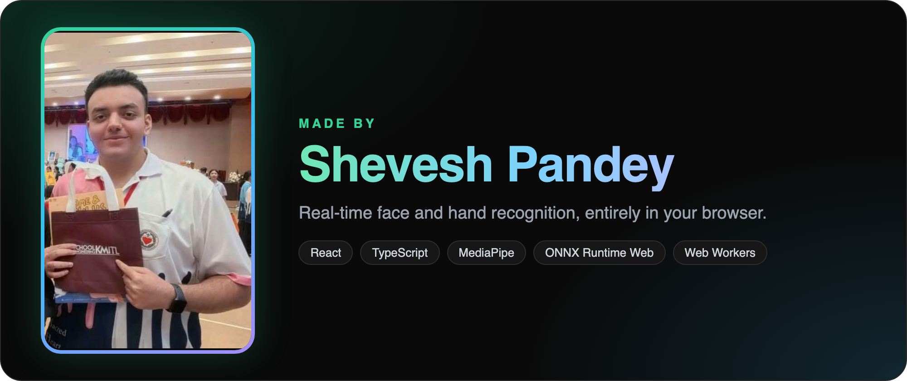
</div>

## Credits and licenses

MediaPipe (Apache-2.0), onnxruntime-web (MIT), SFace from the OpenCV Zoo (Apache-2.0, see above before commercial use),
Three.js, Framer Motion, React, Zustand, Tailwind CSS, Vite, Vitest, Playwright (all MIT), idb (ISC). The README screenshots use the author's own photo as the fake camera input. The test clip
(`tests/fixtures/clip-face.mjpeg`) is made from the official portrait of a former US president (a US government work, public
domain). Photos used to measure accuracy (LFW, AffectNet, CK+) are not in this repository.
